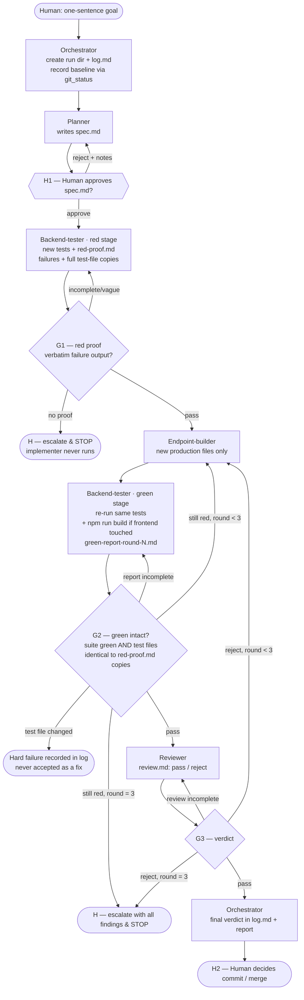

# Orchestration Diagram — TDD Workflow

How a goal moves through the ChessMind TDD pipeline: who does what, what each
handoff carries, how each result is judged, what happens on failure, and where
a human must step in.

Sources: `.claude/agents/{orchestrator,planner,backend-tester,endpoint-builder,reviewer}.md`,
`mcp/tools_server.py`, `mcp/roles.allowlist.json`. Tool grants per role are in
[routing-and-tool-grant-map.md](routing-and-tool-grant-map.md), which the
orchestrator treats as its full contract.

Last updated: 2026-11-17.

---

## 1. End-to-end flow

`H` = human checkpoint. `G` = automated gate the orchestrator enforces.

**G2 after every build.** Every implementer build, whatever triggered it,
goes through the green re-run and G2 before the reviewer sees it. If the test
files are unchanged but the suite is still red, the failing output goes
verbatim back to the implementer. The tester can't touch app code, so the
implementer is the only role that can fix it.

**Round budget.** A round is one implementer build; the first build is round 1.
A still-red green run and a reviewer reject share one budget of 3 rounds per
run. If round 3 is still red or rejected by the reviewer, the run escalates.

**No lint, no verifier.** There is no final verification stage and no ruff or
frontend lint requirement (removed 2026-11-17, decision-009). The green re-run
is the only execution check.

---

## 2. Handoffs: what context is passed

The orchestrator passes **file paths, not summaries**. Each subagent starts
with a fresh context and reads the files itself. Everything for a run lives in
`docs/orchestrator-runs/<run-id>/`, where `<run-id>` = `<slug>-<YYYY-MM-DD>`.

| # | From → To | Context passed in | Output returned |
|---|-----------|-------------------|-----------------|
| 0 | Human → Orchestrator | One-sentence goal + any extra context | Run dir created; baseline (`git status --short`) in `log.md` |
| 1 | Orchestrator → Planner | Goal text, run-id, repo path. On re-plan: human's rejection notes | `spec.md`: testable behaviors, acceptance criteria **as test names**, routes/payloads/status codes, string-`detail` errors, components to mock, files to create, out-of-scope list, plan-line citations, open questions |
| 2 | Orchestrator → Human | `spec.md` | Approve, or reject with changes |
| 3 | Orchestrator → Backend-tester (red) | run-id, `spec.md` path | New file(s) under `backend/tests/`, `red-proof.md` with verbatim failing output and the full content of each new test file, baseline + coverage |
| 4 | Orchestrator → Endpoint-builder | run-id, `spec.md`, `red-proof.md`, failing test file path. On loop: still-red output or reviewer findings **verbatim** | New files under `backend/app/api/**` and optional new `backend/app/services/` modules; handoff contract in `implementer-log.md` in the run dir (overwritten each build): each failing test mapped to the code meant to pass it, routes and status codes traced to spec criteria, how each loop finding was addressed; follow-ups for shared code it was not allowed to touch |
| 5 | Orchestrator → Backend-tester (green) | run-id, `spec.md`, `red-proof.md` path, round number `<N>` | `green-report-round-<N>.md`: verbatim pytest output (green or still red), `npm run build` output if frontend files changed, + per-file comparison against the copies in `red-proof.md` |
| 6 | Orchestrator → Reviewer | run-id, `spec.md`, test file path, changed production file list | `review.md`: exactly **pass** or **reject**. Reject = one finding per line (`file:line`, violated spec statement, suggested direction) |
| 7 | Orchestrator → Human | `log.md` + final message | Verdict, changes vs baseline, rounds used, real vs pending verification, escalations |

---

## 3. How outputs are evaluated

| Stage | Evaluated by | Pass criteria | Rubric / standard |
|-------|--------------|---------------|-------------------|
| Spec | **Human** | Approves `spec.md`. Open questions resolved or accepted | — |
| Red tests | Orchestrator (G1) | `red-proof.md` quotes **verbatim** failure output from a real test run, and every new test file in full | `docs/rubric-test-author.md`, `.memory/knowledge/testing-standards.md` |
| Build | Indirect, through G2 + review | Only new production files. No edits to existing `app/` files, tests, or docs | `docs/rubric-endpoint-builder.md`, `.memory/knowledge/coding-standards.md` |
| Green re-run | Orchestrator (G2) | Suite green: pytest exit 0, plus `npm run build` exit 0 if frontend files changed (quoted output) **and** every test file identical to its copy in `red-proof.md`, no new test files | `docs/rubric-test-author.md` |
| Review | Reviewer → Orchestrator (G3) | Code matches spec (every criterion, status code, shape; nothing out of scope) **and** tests match spec (every criterion tested, real assertions, error paths covered) | `spec.md` |

The orchestrator only enforces the gates and records the evidence it gets. It
never re-does a stage to check it. It also has no `test_runner`, so it cannot
re-run the tests itself.

---

## 4. When a result does not meet the requirements

| Failure | Response | Loop limit | Ends in |
|---------|----------|-----------|---------|
| Human rejects `spec.md` | Re-invoke planner with the human's notes | Unbounded (human-driven) | Back to H1 |
| Any stage output missing or vague | Re-invoke **the same role** with the specific gap, citing the rubric dimension at fault. Orchestrator never fills the gap itself | Not specified | Retry that stage |
| No red proof (G1) | Run **fails**. Escalate to human, stop. Implementer is never invoked | 0 | **Human** |
| Baseline suite already failing, or `STOCKFISH_PATH` missing | Tester reports and stops | 0 | **Human** |
| Missing dependency during build (STOCKFISH_PATH, API key) | Implementer reports and stops; no workaround | 0 | **Human** |
| Test file changed between red and green (G2) | **Hard failure** recorded in `log.md`. Never accepted as a fix | 0 | **Human** (implied) |
| Suite still red at G2, test files unchanged | Failing output passed **verbatim** to implementer | **Max 3** rounds, shared with reviewer rejects | Round 3 still red → **escalate, stop** |
| Reviewer rejects | Findings passed **verbatim** to implementer | **Max 3** rounds, shared with still-red runs | Round 3 rejected → **escalate with accumulated findings, stop** |
| Review incomplete (finding without location or spec statement) | Re-invoke reviewer with clarifying notes | Not specified | Retry review |
| Shared code needs changing | Implementer builds around it and reports a follow-up | — | **Human** decides later |

---

## 5. Human checkpoints

1. **H1 — Spec approval (blocking).** Nothing after the planner runs until a
   human approves `spec.md`.
2. **Escalation stops (blocking).** The run halts and waits for a human on any
   of: no red proof, test files changed during build, the 3-round budget used
   up, a missing dependency, or a baseline that was already failing.
3. **H2 — Commit / merge (always).** The pipeline never commits or merges.
   The human reads the final report and decides.
4. **Follow-ups (non-blocking for the run).** Shared-code changes the
   implementer could not make, open questions left in the spec, and checks
   a role marked pending (such as coverage numbers from a standalone tester run) all need a human
   decision.
